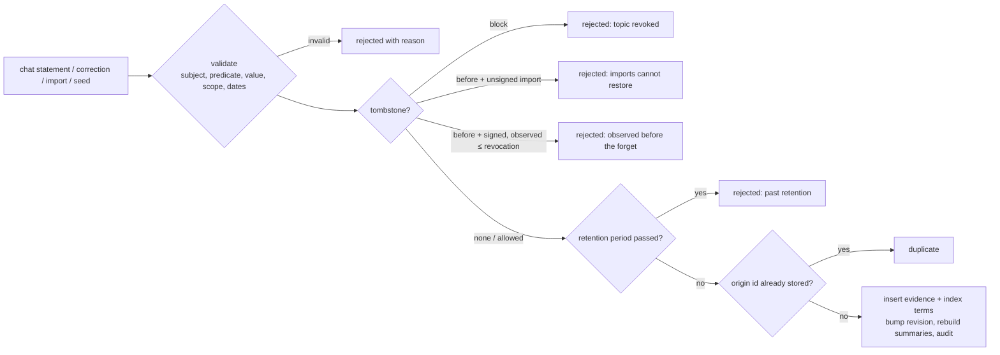
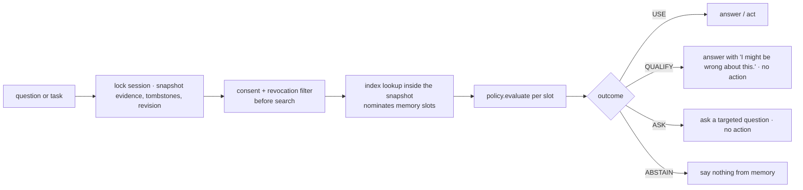
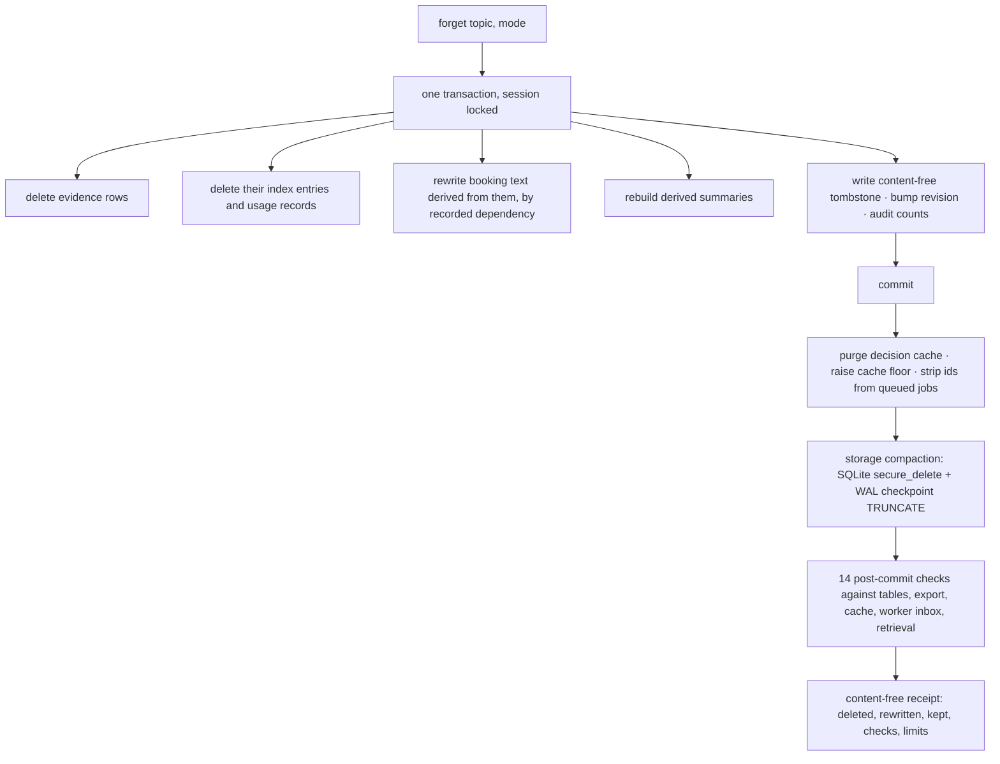

# Architecture

CAVEAT is one Node 24 process. It serves a React UI and a JSON API, and stores everything in PostgreSQL or SQLite. Both stores use the same DDL, and every test runs against both. Nothing calls a language model. The decision policy is a pure function, so every verdict can be reproduced from the stored evidence.

```
browser (React, no authority) ──HTTP/JSON──▶ server.ts ──▶ memory.ts (Caveat) ──▶ db.ts ──▶ PostgreSQL | SQLite
                                               │              │
                                               │              ├─ policy.ts   evaluate(evidence, tombstones, query) → Decision
                                               │              ├─ tasks.ts    plan(...) → slot or block
                                               │              └─ naive.ts    the negative control
                                               └─ session cookie (HttpOnly, SameSite=Strict); sha256(token) is the session id
```

| File | Responsibility |
|---|---|
| `src/model.ts` | Types, the predicate registry (authority, horizons, retention, consent, scope) and value validation |
| `src/policy.ts` | `evaluate()`: access, consent, revocation, scope, validity, corrections, grading, conflict, freshness and the outcome |
| `src/memory.ts` | The `Caveat` class: sessions, the write path, retrieval, tasks, forgetting, retention, import/export and the delayed worker |
| `src/tasks.ts` | The two consequential tasks and the slot planner (private-time avoidance, holds) |
| `src/db.ts` | `Db` interface with `tx(lock, fn)`. SQLite uses `BEGIN IMMEDIATE` behind a promise mutex; PostgreSQL uses `SELECT … FOR UPDATE` on the session row |
| `src/server.ts` | HTTP: sessions, rate limits, CSP and headers, the JSON-only API, static files |
| `ui/src/*` | Assistant, evidence panel, memory inspector, forgetting center |

## Invariants

1. Every row carries its session id, and every mutation locks the session row first. Reads that feed decisions use the same lock, so one decision sees one revision.
2. The server assigns the source kind from the ingestion channel, never from the payload. An unsigned import is a third-party report, whatever it claims to be.
3. The search index never authorises an answer. It only nominates memory slots, and the policy decides from evidence.
4. The backend gate (`book`) recomputes the plan inside its own transaction. A plan the browser saw earlier carries no authority.
5. Forgetting is reported complete only after its transaction commits and the post-commit checks run.
6. Tombstones carry no content: no value and no fingerprint of a value.

## Write path



The **source kind** comes from the channel:
- `chat` gives `user_statement`.
- `correction` gives `user_correction`.
- An **unsigned** import is always `third_party`, with the fixed lineage `unsigned-import` and the label prefix "Unsigned import · ".
- A **signed** import keeps the kind, lineage and dates it was exported with. The signature is an HMAC over the body, which binds it to its session.

Observation time is "now" for anything said now. An import keeps its original time and can never look fresher than it is.

## Retrieval path



`ask()` returns a trace with real server timings per step. A decision cache, keyed by session and revision, sits in front of `decide()`. A forget purges it and raises a per-session floor, so a read that raced the forget can never be cached below the floor.

## Forget path



The delayed worker (`queueDigest` and `releaseDigest`) stands in for work done in another process. A job holds only evidence ids and the revision it was planned against. When it runs it rebuilds its data from current storage under the session lock, and it is fenced: if the revision has moved, it is discarded without writing.

## Deployment

The service runs in a Docker image on Render's free web tier, backed by free Render PostgreSQL 16 (`render.yaml`). It does not use persistent disks. The SQLite mode is for local runs and tests. See [DEPLOY.md](DEPLOY.md).
